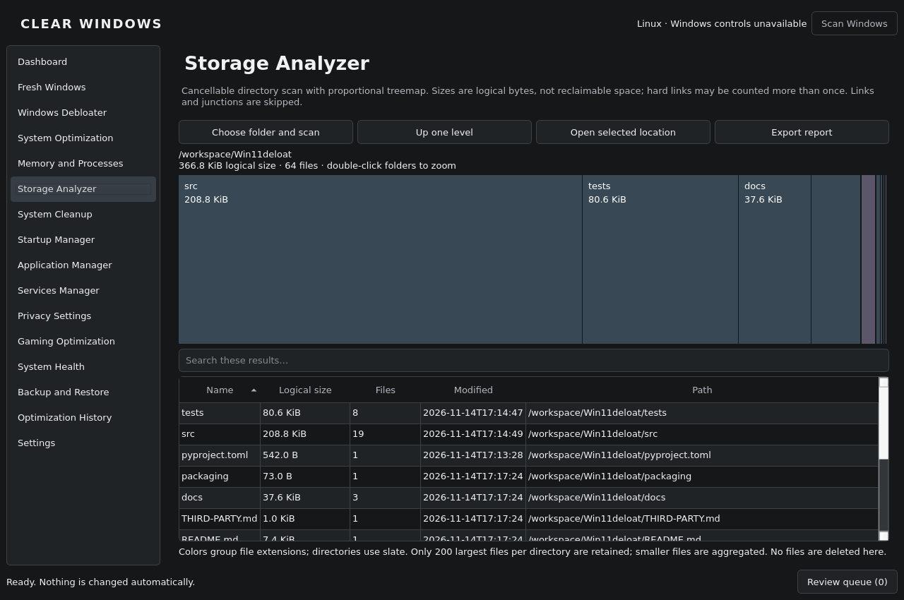

# Clear Windows

A Windows desktop utility for inspecting system overhead, reviewing optional apps, and applying deliberate, auditable changes. Built with Python, Qt for Python, Windows PowerShell, and SQLite. Original interface; no bundled third-party debloat scripts.

**Version 0.1 is a functional development foundation, not the complete requested suite. Windows-changing operations need validation in a disposable Windows VM before use on a personal computer.** See [capability status](docs/STATUS.md) and the [Windows validation checklist](docs/WINDOWS-VALIDATION.md).



*Actual Linux development run; Windows-only controls are unavailable on this platform.*

## Windows downloads

Open [GitHub Releases](https://github.com/Vitor456-arch/Win11deloat/releases) and choose the release assets:

- `ClearWindows-0.1.0-Setup-x64.exe`: per-user installation with shortcuts and an uninstaller. No separate Python installation needed.
- `ClearWindows-0.1.0-Portable-x64.zip`: extract the entire folder and run `ClearWindows.exe`; keep `_internal` next to it.
- `SHA256SUMS.txt`: verify downloads using `Get-FileHash -Algorithm SHA256` in PowerShell.

These are unsigned development-preview packages. Uninstall preserves history and recovery backups outside the installation directory. Read the release notes for the validation boundary.

## Run from source on Windows

Requires Windows 11 (Windows 10 is a compatibility target), 64-bit Python 3.11–3.14, and the built-in Windows PowerShell 5.1. Qt dependency availability depends on your Python/platform combination. Start as a normal user; administrator rights are not required for ordinary inventory or per-user preferences.

```powershell
py -3.12 -m venv .venv
.\.venv\Scripts\python.exe -m pip install -e ".[test]"
.\.venv\Scripts\python.exe -m clearwindows
```

The app is a desktop program, not a web server. There are no API keys or required external services. First install downloads Qt from PyPI; normal operation does not download scripts or send telemetry.

For restore-point creation only, explicitly launch the app from an administrator terminal after checking System Protection for your system drive. The app does not auto-elevate. If a requested restore point cannot be verified, the entire queued session stops before any queued changes.

## What works

- Sixteen organized sections, persistent light/dark/system themes, keyboard-accessible tables, search, numeric sorting, asynchronous scans and measurements.
- Real Windows OS/CPU/GPU, current-user Appx, registered desktop apps, services, startup, optional feature and scheduled task inventory. Unknown measurements are identified as unavailable.
- Fresh Windows recommendations from exact installed package identities in a small reviewed catalog. Presets widen the review list; **no preset selects or removes software automatically**.
- Explicit current-user removal of optional catalog apps, revalidated before execution and checked afterward. Frameworks, resources, non-removable and unknown packages are rejected. No provisioning removal or all-user removal.
- Per-user advertising preference, suggested content, file extensions and Game Mode settings. Current/proposed values, consequences, compatibility limits, permissions and reversal are shown before execution.
- Central queue, final confirmation, optional verified restore point, durable write-ahead Registry backups, execution verification, partial failure records and recovery.
- Process working set, sampled CPU usage, available/cache/committed memory and recent samples. User-confirmed termination checks PID/start time, ownership, executable location and a protected-process denylist.
- Timestamped manual baselines and measured comparisons. These are observations, not causal performance claims or guaranteed idle measurements.
- Real cancellable folder scanning, proportional interactive treemap, keyboard folder navigation, search/sort, logical sizes, modification timestamps and JSON exports. Reparse points and symlinks are skipped.
- Temporary-file **preview only** for the standard current-user temp folder, older than seven days. Native Windows Storage Sense handles actual cleanup.
- Append-only optimization journal, JSON export, exact Registry restoration including originally absent values, and interrupted-operation reconciliation.

## Safe usage

1. Scan Windows and inspect the real findings.
2. Choose a Fresh Windows preset as a filter, inspect an app, then explicitly queue its removal. Preference panels require an explicit current-value inspection before queuing.
3. Review the complete queue. Back up personal app data independently before removal. Restore points do not guarantee app reinstallation or personal-file recovery.
4. Optionally create a restore point, then explicitly authorize execution. Changes are sequential. A failure stops later actions; earlier verified actions remain applied and visible in History.
5. Re-scan after changes. Use Backup and Restore to restore supported Registry values. Store apps can only be reinstalled through official mechanisms if still available; automatic app data recovery is not supported.
6. If interrupted, inspect Recovery. New sessions are blocked until interrupted prepared actions have been reconciled against actual system state. No interrupted action is blindly retried.

System startup apps, general uninstallers, privacy permissions, recovery, gaming settings, and Storage Sense can be managed through buttons opening the corresponding native Windows tools. Service and optional feature editing are deliberately not exposed in this release.

## Develop and test

```bash
python3 -m venv .venv
.venv/bin/python -m pip install -e '.[test]'
QT_QPA_PLATFORM=offscreen .venv/bin/python -m pytest -q
.venv/bin/python -m clearwindows
```

On Linux, only the interface, storage analyzer, exports, and portable tests are supported. Windows system information is **not simulated**. Headless Qt may need `QT_QPA_PLATFORM=offscreen`. On Windows use `.venv\Scripts\python.exe -m pytest -q`.

Tests exercise real temporary-file scans and Qt interaction, plus an injected in-memory Windows adapter to verify destructive-operation policy without modifying the development machine. The Windows read-only integration test runs only on Windows. CI covers Linux and Windows. Version tags trigger setup/portable builds, package smoke tests, SHA-256 checksums and GitHub prerelease publication; this repository does not claim a signed or production-validated release.

## Architecture and data

- `catalog.py`: reviewed optional-package and Registry preference definitions.
- `windows.py`: fixed built-in PowerShell programs; JSON data is encoded separately, never shell-interpolated. No downloaded code. Registry access uses Python's Windows API.
- `engine.py`: immutable queued actions, preflight and per-action validation, write-ahead SQLite journal, result verification and recovery.
- `storage.py`: iterative streaming scan with bounded file retention and cancellation; pure proportional layout.
- `app.py`: Qt presentation and single-worker background jobs. No persistent service.

User state lives in Qt's local application-data directory (shown in Settings). History contains paths and app names; review exported reports before sharing. Theme preference uses QSettings. Back up the history database before moving or deleting it: it contains the original values needed for reversal. No credentials are stored.

## Limitations

The full product brief is preserved in [docs/PRODUCT-BRIEF.md](docs/PRODUCT-BRIEF.md). The release does not yet provide arbitrary service/feature changes, automatic startup toggles, automatic general uninstall, file deletion, leftover removal, full-disk MFT scanning, sensor/SMART readings, FPS overlays or boot-time analysis. See the status document for exact boundaries.

Disk totals are logical bytes, not guaranteed allocated or reclaimable space. Hard links may be counted twice, directory contents can change while scanning, and unavailable paths produce visible errors. The largest 200 files in each directory are retained for display; smaller files are aggregated, so the report is not a complete per-file listing. Millions of directory nodes still require memory; full-volume stress validation is pending.

Licensed under MIT for original code; Qt for Python and its runtime libraries retain their own licenses (see [THIRD-PARTY.md](THIRD-PARTY.md)).

## Build a Windows release

On Windows with Python 3.12 and Inno Setup 6 or 7 installed:

```powershell
python -m pip install -e ".[test]" "pyinstaller==6.16.0"
python -m pytest -q
./packaging/build.ps1 -Version 0.1.0
```

Outputs are written to `release/`. The `Build and publish Windows release` workflow runs on a matching `v0.1.0` tag (version must match `pyproject.toml`). It tests the code, builds both assets, checks the extracted portable app and silent setup/uninstall, then publishes a prerelease with hashes. Existing published assets are never silently overwritten. A failed test/build prevents publication. The manual workflow input can retry the same existing tag after an infrastructure failure.

The onedir bundle dynamically loads Qt DLLs and includes the installed distributions' license files, exact dependency versions, source-availability references and product documentation.
